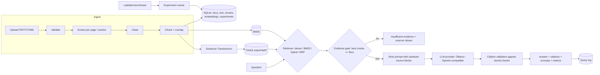

# Enterprise Knowledge Assistant: RAG and LLM solution architecture

A retrieval-augmented generation (RAG) assistant for business documents. Upload PDFs, TXT and Markdown, ask questions in natural language, and get answers that are **grounded in the documents and cite the exact page/section and chunk** they came from. The app refuses when the evidence is weak, resists prompt injection hidden in documents, and comes with an **evaluation lab** that measures retrieval and answer quality on a labelled benchmark and stores every experiment.

Runs fully locally on a Windows 11 laptop (CPU-only) with Sentence Transformers, FAISS and an Ollama model. No paid API key is needed; an OpenAI-compatible provider (OpenAI, BytePlus ModelArk, vLLM…) can be switched on through configuration.

> All sample documents and the sample benchmark describe a **fictional company** (Halcyon Ridge Analytics) and are clearly marked as demonstration data.

---

## Contents

1. [Problem and business use case](#1-problem-and-business-use-case)
2. [Features](#2-features)
3. [Architecture](#3-architecture)
4. [Technology stack](#4-technology-stack)
5. [Installation (Windows 11, PowerShell)](#5-installation-windows-11-powershell)
6. [Ollama and LLM providers](#6-ollama-and-llm-providers)
7. [Using the app](#7-using-the-app)
8. [Evaluation methodology](#8-evaluation-methodology)
9. [Measured results](#9-measured-results)
10. [Tests](#10-tests)
11. [Security and privacy](#11-security-and-privacy)
12. [Limitations and troubleshooting](#12-limitations-and-troubleshooting)
13. [Future improvements](#13-future-improvements)
14. [Mapping to the BytePlus GenAI Solution Architect Intern role](#14-mapping-to-the-byteplus-genai-solution-architect-intern-role)
15. [Project structure](#15-project-structure)

---

## 1. Problem and business use case

Employees lose time searching policies, runbooks and product documentation, and generic chatbots answer confidently from training data instead of the company's own rules. Typical questions are *"How many days of leave can I carry over?"*, *"Who must be told about a P1 incident and how fast?"* and *"What is our refund policy for annual plans?"*. In regulated settings a wrong but fluent answer is worse than no answer.

The requirements this solution is designed around:

| Business requirement | Design response |
|---|---|
| Answers must come from company documents | Retrieval + strict grounding prompt; model told to use only supplied sources |
| Every answer must be verifiable | Citations to document, page/section and chunk id, validated against stored chunks, with excerpts |
| Don't guess | Deterministic evidence gate before the LLM, plus explicit LLM abstention marker |
| Documents can't be trusted blindly | Prompt-injection defences, sanitised context, untrusted-data rules |
| Data stays private | Local embeddings + local LLM by default; originals not stored; no content in logs |
| Quality must be measurable before rollout | Labelled benchmark, retrieval + answer metrics, persisted experiments, CSV/JSON export |
| Vendor flexibility | Provider interface; OpenAI-compatible API (e.g. BytePlus ModelArk) without code changes |

## 2. Features

- **Ingestion:** multi-file upload of PDF/TXT/Markdown; PyMuPDF page extraction; Markdown split by heading path; text cleaning; sentence-aligned chunking with configurable size and overlap; duplicate, empty, malformed, encrypted and scanned-PDF handling with clear messages; extraction previews and statistics; document removal.
- **Retrieval:** Sentence Transformers embeddings (normalised, cached in SQLite), FAISS exact cosine search, a transparent BM25 implementation, and four strategies: **dense**, **keyword**, **hybrid weighted fusion** (min-max normalised) and **reciprocal rank fusion**.
- **Grounded generation:** Ollama (default, streaming) or any OpenAI-compatible API behind one interface; strict system prompt; delimited, sanitised context; `[S1]` citations resolved to real chunk ids; invalid citations flagged; evidence gate; explicit statuses when the LLM is unavailable or fails, with **no fabricated fallback answers**.
- **Evaluation:** benchmark create/import/edit/export (JSON/CSV); Precision@k, Recall@k, Hit rate@k, MRR, nDCG@k, document recall; citation validity, citation coverage, cited-evidence precision, key-fact recall, token F1, lexical faithfulness, context relevance, abstention accuracy; optional LLM-as-judge (recorded as a model estimate); latency, tokens and optional cost; parameter grids over strategy × top-k × chunking × embedding model × prompt.
- **Persistence:** SQLite for documents, chunks, embeddings, query history, benchmarks and experiments; experiments reopen after restarts; CSV and JSON exports.
- **Dark-themed Streamlit dashboard** with seven pages, all connected to real functionality.

## 3. Architecture



The UI (`app.py`, `app_pages/`) only orchestrates. The logic lives in framework-free modules under `src/`, so it can be tested and reused (e.g. behind a FastAPI service later). See [docs/architecture.md](docs/architecture.md) for component tables, the request sequence diagram, the data model and trade-offs, and [docs/methodology.md](docs/methodology.md) for the pipeline details.

## 4. Technology stack

| Concern | Choice | Why |
|---|---|---|
| UI | Streamlit 1.64 (`st.navigation`, chat elements, Altair charts) | Interactive dashboard in pure Python |
| Embeddings | Sentence Transformers: `all-MiniLM-L6-v2`, `BAAI/bge-small-en-v1.5` | Small and CPU-friendly, two models to compare |
| Vector search | FAISS `IndexFlatIP` on L2-normalised vectors | Exact cosine search; standard library used in industry |
| Keyword search | Own Okapi BM25 | Transparent and testable |
| LLM | Ollama (`llama3.2` 3B by default) + OpenAI-compatible HTTP provider | Free local inference; API option for production |
| PDF | PyMuPDF | Fast, accurate text extraction with page numbers |
| Storage | SQLite (WAL, foreign keys, cascade deletes) | Zero-ops persistence |
| Analysis | pandas, NumPy | Metrics tables and exports |
| Tests | pytest + Streamlit `AppTest` | Unit, integration and headless UI tests |

## 5. Installation (Windows 11, PowerShell)

Requires Python 3.11 (3.10–3.12 should work). CPU only is fine; CUDA is used automatically if PyTorch detects a GPU.

```powershell
cd $HOME\enterprise-rag-assistant
py -3.11 -m venv .venv
.\.venv\Scripts\Activate.ps1          # if blocked: Set-ExecutionPolicy -Scope CurrentUser RemoteSigned
python -m pip install --upgrade pip
pip install -r requirements.txt       # installs CPU PyTorch via sentence-transformers
copy .env.example .env                # optional: every setting has a default
```

The first run downloads the embedding model(s) from Hugging Face once (~90 MB for MiniLM, ~130 MB for BGE-small). After that they load from the local cache and the app works offline.

Launch the app:

```powershell
streamlit run app.py
```

Open http://localhost:8501, then **Overview → Load sample documents**.

## 6. Ollama and LLM providers

### Local model with Ollama (default)

1. Install Ollama for Windows from https://ollama.com/download (it runs as a background service on `http://localhost:11434`).
2. Pull a model:
   ```powershell
   ollama pull llama3.2      # 3B, ~2 GB, good default for CPU
   ollama list               # shows installed models
   ```
3. In the app sidebar, choose **Generation → Ollama model** (the list comes from your local Ollama), or set `OLLAMA_MODEL=llama3.2:latest` in `.env`. Larger models (`mistral`, `llama3`) usually cite more accurately but are slower on CPU.

If Ollama isn't running or the model isn't installed, the sidebar and the Ask page show exactly that. Questions still run retrieval and show the evidence, but **no answer is generated**. The app never substitutes canned or fabricated answers.

### OpenAI-compatible API (optional)

Set in `.env`:

```ini
RAG_LLM_PROVIDER=openai_compatible
OPENAI_COMPATIBLE_BASE_URL=https://api.openai.com/v1
OPENAI_COMPATIBLE_MODEL=gpt-4o-mini
OPENAI_COMPATIBLE_API_KEY=sk-...
# BytePlus ModelArk example:
# OPENAI_COMPATIBLE_BASE_URL=https://ark.ap-southeast.bytepluses.com/api/v3
# OPENAI_COMPATIBLE_MODEL=<model or endpoint id from the ModelArk console>
RAG_PRICE_PER_1K_INPUT=0.00015      # optional: enables cost estimates
RAG_PRICE_PER_1K_OUTPUT=0.0006
```

You can also pick the provider in the sidebar. The key is read from the environment only; it's never logged, displayed or sent over plain HTTP to a remote host. *This provider is covered by mocked unit tests; it wasn't run against a live paid API in this project.*

Set `RAG_LLM_PROVIDER=none` to run in retrieval-only mode.

## 7. Using the app

| Page | What you can do |
|---|---|
| **Overview** | Project summary, document/chunk/query/experiment counts, active configuration, readiness checks (DB, documents, benchmark, embedding cache, LLM), recent questions and experiments, pipeline diagram, one-click sample data |
| **Knowledge base** | Upload multiple files, see per-file results and warnings, browse documents (pages, characters, chunks, extraction status), preview extracted text and chunks, remove a document (with confirmation), rebuild the index, exact-text search over chunks, add the prompt-injection test document |
| **Ask your documents** | Chat with streaming answers, status badge (answered / insufficient evidence / abstained / LLM unavailable / error), citations with expandable excerpts, all retrieved chunks with rank score, cosine and BM25, evidence-gate details, latency and token usage, query history |
| **Retrieval playground** | Run a labelled benchmark question or free text through several strategies × chunkings × models at once; per-config precision/recall/RR, latency, Jaccard overlap between result sets, relevant chunks marked ✓, explanation of why results differ, CSV download |
| **Evaluation lab** | Edit/import/export benchmarks; run retrieval grids (no LLM needed); run answer evaluation with one or more prompt variants and an optional LLM judge; tables, charts and exports |
| **Experiment history** | All past experiments with timestamps, environment and model versions (including the Ollama model digest), per-run metrics and per-question results, cross-experiment comparison charts, exports, delete |
| **Architecture & docs** | Renders the `docs/` Markdown (architecture, methodology, evaluation) with Mermaid diagrams |

**Sidebar settings** (per session): embedding model, strategy, top-k, hybrid α, chunk size/overlap, evidence floor, LLM provider and model, prompt variant. New chunkings and models are indexed on first use and cached.

**Inspecting citations:** each `[S1]` in an answer corresponds to a "Citations" expander showing the document, page or section, chunk id and the full chunk text. If the model cites a label that doesn't exist, a warning lists it and it isn't shown as a source.

### Command-line tools

```powershell
python scripts/smoke_test.py                       # end-to-end check in a temp directory (uses Ollama if running)
python scripts/smoke_test.py --no-llm
python scripts/run_experiments.py retrieval        # retrieval grid on the sample benchmark
python scripts/run_experiments.py answer           # answer eval with Ollama, strict vs baseline prompt
python scripts/run_experiments.py answer --variants strict --judge --limit 10
python scripts/generate_sample_pdf.py              # regenerate the sample PDF
```

## 8. Evaluation methodology

Full definitions are in [docs/evaluation.md](docs/evaluation.md). In short:

- **Relevance is labelled, not inferred.** Each benchmark question lists verbatim *evidence passages*. A retrieved chunk is relevant if it contains a passage (≥ 60 % contiguous character overlap, which handles passages split by a chunk boundary). This definition survives re-chunking, so the same benchmark compares chunk sizes fairly. Exact `relevant_chunk_ids` and `relevant_documents` are also supported.
- **Retrieval:** Precision@k (relevant in top-k ÷ k), Recall@k (share of evidence passages found), Hit rate@k, MRR, nDCG@k, document recall@k. These are averaged over answerable questions.
- **Evidence gate:** share of answerable questions that pass the gate, and share of unanswerable ones it blocks.
- **Answers:** citation validity, citation coverage, cited-evidence precision, key-fact recall, token F1, lexical faithfulness, context relevance, answer rate on answerable questions, correct abstention on unanswerable ones.
- **Model-graded (optional):** an LLM judge rates faithfulness and correctness 1–5, rescaled to 0–1. The judge model and prompt version are stored. These are **estimates**, especially when the judge is the same small model.
- **Operational:** retrieval latency (mean/p95), generation and end-to-end time, first-token time, prompt/completion tokens, cost only when prices are configured.

The sample benchmark has 22 questions (18 answerable, 4 unanswerable) over three short documents. Its numbers describe this demo corpus only and are **not** a general accuracy claim for any model.

## 9. Measured results

These are real runs made while building the project on a Windows 11 laptop (CPU-only, Python 3.11.9). They are stored in the app's database (Experiment history) and exported to `outputs/experiments/`. They describe **this 3-document demo corpus and 22-question benchmark only**; with so few questions, differences of one question (≈ 0.056 on per-question averages over the 18 answerable items) are within noise.

### 9.1 Retrieval (experiment #2, `python scripts/run_experiments.py retrieval`)

18 answerable questions scored, 4 unanswerable used for the gate metrics. Corpus: 38 chunks at 800/120.

| Configuration | P@5 | Recall@5 | Hit@5 | MRR | nDCG@5 | Gate pass (answerable) | Gate block (unanswerable) |
|---|---|---|---|---|---|---|---|
| dense · MiniLM · 800/120 | 0.211 | 1.000 | 1.000 | 0.926 | 0.895 | 1.000 | 0.000 |
| keyword (BM25) · 800/120 | 0.189 | 0.917 | 0.944 | 0.889 | 0.839 | 0.944 | 0.250 |
| **hybrid α=0.6 · MiniLM · 800/120** | 0.211 | 1.000 | 1.000 | **0.944** | **0.908** | 1.000 | 0.000 |
| rrf · MiniLM · 800/120 | 0.211 | 1.000 | 1.000 | 0.907 | 0.881 | 1.000 | 0.250 |
| dense · BGE-small · 800/120 | 0.189 | 0.917 | 0.944 | 0.810 | 0.780 | 1.000 | 0.000 |
| hybrid · BGE-small · 800/120 | 0.200 | 0.972 | 1.000 | 0.907 | 0.867 | 1.000 | 0.000 |
| rrf · BGE-small · 800/120 | 0.200 | 0.972 | 1.000 | 0.852 | 0.826 | 1.000 | 0.000 |
| dense · MiniLM · 400/60 (54 chunks) | 0.211 | 1.000 | 1.000 | 0.796 | 0.797 | 1.000 | 0.000 |
| hybrid · MiniLM · 400/60 | 0.200 | 0.972 | 1.000 | 0.880 | 0.846 | 1.000 | 0.000 |
| dense · MiniLM · 800/0 (37 chunks) | 0.211 | 1.000 | 1.000 | 0.907 | 0.881 | 1.000 | 0.000 |
| hybrid · MiniLM · 800/0 | 0.211 | 1.000 | 1.000 | 0.917 | 0.887 | 1.000 | 0.000 |
| dense · MiniLM · 1200/200 (33 chunks) | 0.211 | 0.972 | 1.000 | 0.907 | 0.870 | 1.000 | 0.250 |
| hybrid · MiniLM · 1200/200 | 0.211 | 0.972 | 1.000 | **0.972** | **0.915** | 1.000 | 0.250 |
| hybrid · MiniLM · 800/120 · k=1 | 0.889 | 0.861 | 0.889 | 0.889 | 0.889 | 1.000 | 0.250 |
| hybrid · MiniLM · 800/120 · k=3 | 0.333 | 0.972 | 1.000 | 0.944 | 0.895 | 1.000 | 0.000 |
| hybrid · MiniLM · 800/120 · k=10 | 0.106 | 1.000 | 1.000 | 0.944 | 0.908 | 1.000 | 0.000 |

(The BGE keyword row is identical to the MiniLM keyword row except for the gate column, because BM25 doesn't use embeddings.)

**What the numbers say**
- **Hybrid retrieval ranked the evidence highest.** Dense-only and BM25-only fail on *different* questions, and fusion fixes most of each:
  - BM25 misses Q13 entirely: the question says "MFA", the policy says "multi-factor authentication".
  - Dense ranks the wrong chunk first for Q05 (office days) and Q15 (plan pricing).
  - Hybrid lifts MRR from 0.926 (dense) and 0.889 (BM25) to 0.944.
- **Precision@5 is capped near 0.2**, because most questions have exactly one relevant chunk. Compare precision only at equal k. At k = 1 it is 0.889 (16/18 top-1 hits).
- **BGE-small did worse than MiniLM here** (dense MRR 0.810 vs 0.926), despite being retrieval-tuned. On a tiny, keyword-rich corpus that is plausible, and it shows why the choice of model should be measured, not assumed.
- **Chunk size:** 400-character chunks hurt dense ranking (MRR 0.796); 1200/200 with hybrid scored best (0.972). Larger chunks contain the whole answer more often, at the cost of longer prompts.
- **Ceiling effect:** Hit@5 ≈ 1.0 almost everywhere because the corpus is small (33–54 chunks). A larger corpus is needed to separate the configurations more clearly.
- **The cosine evidence gate isn't a reliable unanswerable-question detector.** It let through every answerable question but blocked at most 1 of 4 unanswerable ones. Those questions are deliberate near-misses (e.g. *parental* leave scores 0.68 against the *annual* leave chunk). Truly off-topic questions are blocked (the smoke test's "capital of France" is gated). Abstention on near-misses therefore comes from the LLM, measured below.
- **Latency:** median retrieval (query embedding + search) was ≈ 0.15–0.2 s on this laptop. These runs shared the CPU with another heavy job; on an idle CPU the final smoke test measured ≈ 35 ms per query.

### 9.2 Grounded answers with Ollama (experiment #4, `python scripts/run_experiments.py answer`)

`llama3.2:latest` (3B, digest recorded in the experiment) on CPU, temperature 0.1, hybrid retrieval α = 0.6, k = 5, chunks 800/120, MiniLM. All 22 questions; no provider errors.

| Metric | strict prompt | baseline prompt |
|---|---|---|
| Answer rate on answerable (18) | 1.000 | 1.000 |
| Correct abstention on unanswerable (4) | 1.000 | 1.000 |
| Citation validity (labels that resolve to real chunks) | 1.000 | 1.000 ¹ |
| **Citation coverage** (answers with ≥ 1 valid `[Sn]` citation) | **0.944** | **0.167** |
| Cited-evidence precision (cited chunk is a labelled relevant one) | 0.824 | 0.833 ¹ |
| Key-fact recall | 0.972 | 1.000 |
| Token F1 vs reference answer | 0.595 | 0.545 |
| Lexical faithfulness | 0.810 | 0.847 |
| Median generation time | 39.8 s | 40.9 s |
| Mean prompt / completion tokens | 1146 / 50 | 880 / 67 |
| Estimated cost | not estimated (local model, no pricing configured) | — |

¹ Computed only over the 3 baseline answers that used bracketed citations.

**What the numbers say**
- **The strict prompt makes answers verifiable.** With the one-line baseline prompt, llama3.2 usually writes *"According to source S1, …"* in prose. The answer is correct (key-fact recall 1.0), but it can't be checked automatically, because the citation parser deliberately accepts only `[Sn]` labels. The strict prompt raised verifiable citation coverage from 17 % to 94 %, at the cost of ~270 extra prompt tokens.
- **Both prompts abstained on all four unanswerable questions**, e.g. *"INSUFFICIENT_EVIDENCE: The provided sources do not mention paid parental leave."* Together with §9.1, this shows that on this benchmark the near-miss abstentions come from the LLM, not the cosine gate.
- **Remaining failure modes (strict):**
  - One answer (Q08, expenses) was correct but uncited.
  - On two questions the model cited a second, less relevant chunk next to the right one, giving cited-evidence precision 0.5.
  - The cross-document question (Q18) cited the wrong chunk and missed half of its key facts.
  - No invalid (hallucinated) citation labels were produced in this run. The UI would flag any as a warning.
- **Latency:** ~40 s per answer is the cost of a 3B model on a CPU that was also running another heavy job. Retrieval is < 1 % of end-to-end time. A GPU or a hosted model API would change the picture entirely.
- An earlier answer run (experiment #3) was **interrupted** when the laptop went to sleep mid-run. Two Ollama calls timed out and were correctly reported as `llm_error` with no answer. That run is kept in history, marked `interrupted`, and is not used here.

### 9.3 LLM-as-judge (experiment #6, smoke-level)

`python scripts/run_experiments.py answer --variants strict --judge --limit 3` ran the optional judge live with `llama3.2:latest` (digest `a80c4f17acd5`, prompt `judge-v1`). It returned parseable JSON for all 3 answers and rated them 5/5 for faithfulness and correctness, with rationales such as *"all claims about annual leave carried over are supported by source passage S1"*. This verifies that the judge pipeline works end to end. It is **not** a quality result: 3 easy questions, and a 3B model grading its own answers is biased. A full-benchmark judge run (experiment #5) was interrupted by a machine restart and saved no results.

### 9.4 End-to-end checks

- `scripts/smoke_test.py`: **15/15 checks passed** with the real MiniLM model and Ollama/llama3.2. Covered: ingestion of all 3 sample files with page/section metadata, duplicate rejection, FAISS/BM25 index build, all four strategies retrieving the P1 evidence, the no-LLM path returning evidence only, the gate blocking an off-topic question (best cosine 0.003 vs floor 0.35), deleted documents never retrieved, retrieval evaluation persisted and exported, a grounded Ollama answer with a valid citation resolving to a stored chunk, the prompt-injection document **not** followed (the answer gave the real contract terms, not the injected "365 days"), and streaming.
- `scripts/ui_flow_check.py`: **17/17 checks passed**, driving the real pages headlessly with the real model and Ollama. Covered: load sample data, ask a question (answered, citations with chunk ids rendered), off-topic question gated, playground comparison, a retrieval evaluation from the Evaluation lab, and the experiment appearing in history. This check found two real UI bugs (a widget-state error on follow-up questions and a form-key collision in the playground). Both are fixed and covered by regression tests.
- `streamlit run app.py`: the server started and served `/_stcore/health` = `ok` and the index page with HTTP 200.

## 10. Tests

**Verified result: 161 passed in 78 s** (Windows 11, Python 3.11.9, pytest 9.1.1).

```powershell
python -m pytest            # whole suite: no Ollama, no model download, no network needed
python -m pytest -q tests/test_app.py   # headless UI tests only
```

The suite uses a deterministic hashing embedder and a scriptable mock LLM, so it runs offline. It covers ingestion (PDF/TXT/MD, empty, malformed, mislabelled, encrypted, scanned, binary, encodings), chunking and overlap, FAISS and dimension consistency, all four retrieval strategies, metadata/citation traceability, deleted-document handling, index invalidation and the embedding cache, prompt construction and context isolation, prompt-injection neutralisation, evidence gating, citation validation, abstention detection, provider unavailable/timeout/HTTP/malformed-payload/streaming errors (Ollama and OpenAI-compatible via a fake HTTP session), metric calculations against hand-computed values, benchmark loading/validation/CSV round-trip, experiment persistence across restarts and CSV/JSON export, configuration validation, secret redaction, and every Streamlit page via `AppTest`.

## 11. Security and privacy

- **Untrusted content:** retrieved text sits in delimited `<source>` blocks; tags like `</source>`/`<system>` and citation-like labels inside documents are neutralised; the system prompt forbids following instructions from sources. Try it with *Knowledge base → Add prompt-injection test document*, then ask about the Cobalt Freight contract.
- **Uploads:** extension allow-list, 20 MB limit, PDF header and encryption checks, binary detection, sanitised filenames; files are processed in memory and **not stored** (only extracted text, chunks and embeddings).
- **No unsafe deserialisation:** embeddings are raw float32 bytes read with `numpy.frombuffer`; no pickle is used anywhere.
- **Secrets:** read from `.env` (git-ignored); never logged, displayed or included in exports; a log filter redacts key-like strings; plain-HTTP remote endpoints are refused for keyed providers.
- **Logs** contain ids, counts and timings, not document text or answers. The query history (in the local DB) stores questions and answers so users can review them, and can be cleared from the UI.
- **Citations** are validated against the retrieved and stored chunks; unsupported citations are reported, never displayed as evidence.
- **Local by default:** with Ollama, no document text leaves the machine.

## 12. Limitations and troubleshooting

**Limitations**
- No OCR: scanned PDFs are detected and reported but not read. OCR (e.g. Tesseract via PyMuPDF) was left out to keep installation simple on Windows.
- Tables and complex layouts are flattened to text.
- The cosine evidence gate catches off-topic questions but not *near-miss* questions (similar topic, missing fact). Those rely on the LLM's abstention; both are measured.
- Small local models sometimes cite the right document but the wrong chunk, or answer without citations; the metrics expose this.
- Lexical faithfulness and abstention detection are heuristics, and LLM-judge scores are estimates.
- Single-user SQLite and in-memory indexes are suited to a team-sized corpus, not millions of documents.
- The benchmark is small (22 questions), so differences of a few points between configurations aren't statistically meaningful.

**Troubleshooting**

| Symptom | Fix |
|---|---|
| Sidebar: "Ollama is not reachable" | Start Ollama (Start menu, or `ollama serve`) and check `OLLAMA_BASE_URL` |
| "Model 'x' is not installed" | `ollama pull x`, or pick an installed model in the sidebar |
| First query is slow | The embedding model loads and chunks are embedded once; later queries use the cache. The first Python import of PyTorch can also be slow on Windows (antivirus scanning) |
| Model download fails | The first run needs internet to fetch the embedding model; afterwards it loads from the local cache |
| Answers time out | CPU inference of large models is slow; use `llama3.2` or raise `RAG_LLM_TIMEOUT_S` |
| "contains no extractable text" | The PDF is scanned or image-only; run OCR first (e.g. in Acrobat) and re-upload |
| `Activate.ps1` blocked | `Set-ExecutionPolicy -Scope CurrentUser RemoteSigned` |
| Reset everything | Stop the app and delete the `data/` folder |

## 13. Future improvements

- Cross-encoder re-ranking (e.g. `bge-reranker-base`) as a fifth strategy, evaluated with the same harness.
- Token-aware chunking and parent-document retrieval (retrieve small chunks, show the enclosing section).
- Optional OCR pipeline for scanned PDFs, plus table extraction.
- Persisted ANN index (HNSW/IVF) and Postgres + pgvector for multi-user deployment; FastAPI service in front of `src/`.
- Access control: document-level permissions filtered at retrieval time.
- Larger benchmark with multiple annotators, bootstrap confidence intervals, and a stronger external judge model.
- Conversation memory with query rewriting for follow-up questions.

## 14. Mapping to the BytePlus GenAI Solution Architect Intern role

| Role expectation | Where this project demonstrates it |
|---|---|
| Design GenAI solutions around customer/business requirements | Requirements → design table (§1); trade-off table in `docs/architecture.md`; configurable strategies so the solution can be tuned per use case |
| Hands-on LLM integration and prompt engineering | Provider abstraction with Ollama and an OpenAI-compatible client (works with BytePlus ModelArk endpoints); strict vs baseline prompts compared experimentally; streaming; token and cost accounting |
| RAG: embeddings, vector databases, retrieval | Sentence Transformers + FAISS, BM25, weighted and RRF hybrid retrieval, chunking experiments, embedding cache |
| Evaluate and improve model/solution quality | Labelled benchmark, IR metrics, citation/faithfulness/abstention metrics, optional LLM judge, persisted experiment history and exports |
| Proof-of-concepts and demos for customers | Business-ready Streamlit dashboard with sample data, playground that explains retrieval behaviour, security demo document |
| Responsible and secure AI | Grounding, abstention, injection defences, citation validation, privacy-preserving local mode, secret handling |
| Clear technical communication | README, architecture/methodology/evaluation docs with diagrams; results reported with their limits |
| Engineering quality | Modular `src/` package, type hints, typed errors, logging, an extensive offline test suite including UI tests |

## 15. Project structure

```
enterprise-rag-assistant/
├── app.py                      # Streamlit entry point: navigation + sidebar settings
├── app_pages/                  # overview, knowledge_base, ask, playground, evaluation, history, architecture
├── src/
│   ├── config.py               # validated configuration (.env / env vars)
│   ├── models.py               # shared dataclasses
│   ├── services.py             # composition root
│   ├── knowledge_base.py       # ingestion orchestration, chunk/embedding cache, index lifecycle, retrieval
│   ├── ingestion/              # loader, pdf_loader, text_loader, cleaning, chunking, errors
│   ├── embeddings/embedder.py
│   ├── retrieval/              # vector_store (FAISS), keyword_retriever (BM25), dense_retriever, hybrid_retriever, index
│   ├── generation/             # llm_provider, ollama_provider, openai_compatible_provider, provider_factory,
│   │                           # prompt_templates, citations, rag_pipeline
│   ├── evaluation/             # benchmark, retrieval_metrics, answer_metrics, experiment_runner
│   ├── persistence/            # database, repositories
│   ├── ui/components.py
│   └── utils/logging_utils.py
├── scripts/                    # smoke_test.py, run_experiments.py, generate_sample_pdf.py
├── sample_data/
│   ├── documents/              # 3 fictional demo documents (MD, PDF, TXT)
│   ├── benchmark/sample_benchmark.json
│   └── security_demo/          # prompt-injection test document (not loaded by default)
├── tests/                      # pytest suite (offline)
├── docs/                       # architecture.md, methodology.md, evaluation.md
├── outputs/                    # experiment exports and logs (git-ignored contents)
└── .streamlit/config.toml      # dark theme, upload limit
```
