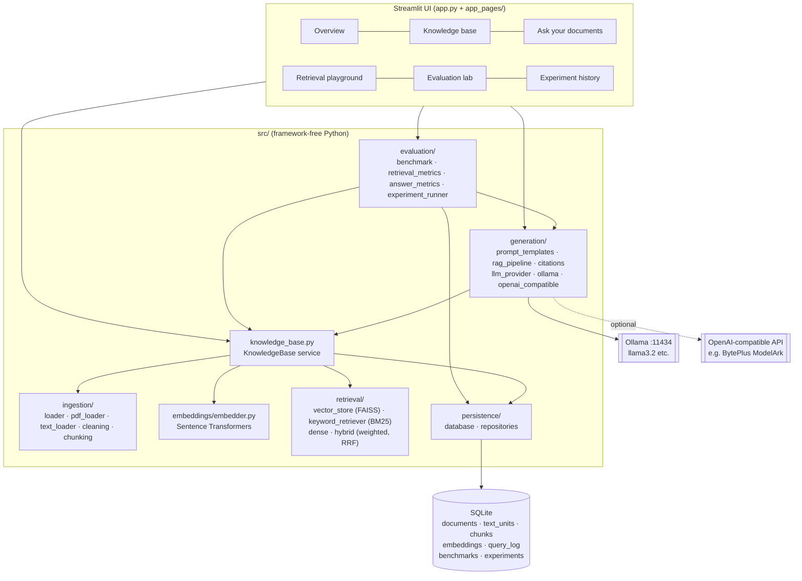

# Architecture

## System overview



The UI only orchestrates. All logic lives in `src/` and is unit-tested without Streamlit. `src/services.py` is the composition root that wires the object graph for the UI and the CLI scripts.

## Request flow: question → grounded answer

```mermaid
sequenceDiagram
    participant U as User
    participant P as RAGPipeline
    participant K as KnowledgeBase
    participant L as LLMProvider
    U->>P: question
    P->>K: retrieve(question, settings)
    K->>K: get_index(chunking, model) (cached per corpus version)
    K->>K: embed query → FAISS top-N, BM25 top-N → fuse → top-k
    K-->>P: ranked chunks + scores + timings
    P->>P: evidence gate (best cosine ≥ floor?)
    alt evidence too weak
        P-->>U: "insufficient evidence" + retrieved chunks (LLM not called)
    else sufficient
        P->>P: build prompt (system rules + <source id=S1 …> blocks)
        P->>L: chat(messages) / stream
        L-->>P: answer text with [S1] labels
        P->>P: resolve labels → stored chunk ids; flag invalid labels
        P-->>U: answer + citations + excerpts + latency/tokens
    end
```

## Components

| Layer | Module | Responsibility |
|---|---|---|
| Ingestion | `ingestion/loader.py` | Validate extension/size/header, sanitise filename, dispatch to loaders, reject empty text |
| | `ingestion/pdf_loader.py` | PyMuPDF per-page extraction from in-memory bytes; detects image-only (scanned) pages and encrypted files |
| | `ingestion/text_loader.py` | Encoding detection (UTF-8/16, cp1252, latin-1), binary rejection, Markdown split by heading path |
| | `ingestion/cleaning.py` | NFKC, control chars, de-hyphenation, whitespace normalisation |
| | `ingestion/chunking.py` | Sentence-aware packing to `chunk_size` chars with sentence-aligned overlap; never crosses a page/section |
| Embeddings | `embeddings/embedder.py` | `Embedder` protocol; Sentence Transformers with L2 normalisation, query prefixes (BGE), CUDA if available, local-cache-first loading |
| Retrieval | `retrieval/vector_store.py` | FAISS `IndexFlatIP` (exact cosine on normalised vectors) + id mapping |
| | `retrieval/keyword_retriever.py` | Transparent Okapi BM25 (k1 = 1.5, b = 0.75) and tokenizer |
| | `retrieval/dense_retriever.py`, `hybrid_retriever.py` | Dense, keyword, weighted fusion and RRF strategies |
| | `knowledge_base.py` | Ingestion orchestration, per-config chunking, embedding cache, index cache keyed by corpus version |
| Generation | `generation/llm_provider.py` | Provider ABC, typed errors (unavailable / timeout / response), usage, cost estimate |
| | `generation/ollama_provider.py` | Ollama `/api/chat` (sync + streaming), model listing, status |
| | `generation/openai_compatible_provider.py` | Any `/chat/completions` API (OpenAI, BytePlus ModelArk, vLLM…) via `requests` |
| | `generation/prompt_templates.py` | System prompts (strict / baseline), delimited context, injection neutralisation |
| | `generation/citations.py` | Label parsing, resolution to real chunks, abstention detection |
| | `generation/rag_pipeline.py` | Retrieval → evidence gate → prompt → LLM → citation validation; sync and streaming |
| Evaluation | `evaluation/*` | Benchmark schema/IO, retrieval and answer metrics, LLM judge, experiment runner + export |
| Persistence | `persistence/*` | SQLite schema, repositories (all SQL is parameterised) |
| UI | `app.py`, `app_pages/`, `ui/components.py` | Navigation, session settings, pages, shared rendering |

## Data model (SQLite)

- `documents` — one row per upload: id (first 12 hex of SHA-256), filename, type, full content hash (duplicate detection), pages, characters, metadata, extraction warnings.
- `text_units` — extracted, cleaned text per page/section. This is what allows re-chunking for experiments **without keeping the original file**.
- `chunks` — `chunk_id = {doc_id}-cs{size}_ov{overlap}-{index}`, chunking key, page, section, character offsets, text.
- `embeddings` — float32 vectors as raw bytes per (chunk, model). Decoded with `numpy.frombuffer`; no pickle anywhere.
- `query_log`, `benchmarks`, `experiments` → `experiment_runs` → `run_results`.
- `ON DELETE CASCADE` from documents to text, chunks and embeddings; deleting a document also bumps `corpus_version`.

## Index lifecycle and deleted documents

Indexes are kept in memory per `(chunking key, embedding model)` and tagged with the corpus version. Any add/remove increments the version, so the next query rebuilds the index from SQLite (re-using cached embeddings, so only new chunks are embedded). Retrieval results are additionally filtered against the set of active document ids. A deleted document can't come back from a stale index.

FAISS indexes are not written to disk. With exact flat search and cached embeddings, rebuilding is fast for this scale (a few thousand chunks) and avoids keeping index files in sync with the database. At larger scale, the next step is to persist an IVF/HNSW index per corpus version.

## Design trade-offs

| Decision | Why | Cost / alternative |
|---|---|---|
| Flat (exact) FAISS index | Exact results, no training, trivial to explain | O(n) per query; switch to HNSW/IVF beyond ~10⁵ chunks |
| Own BM25 instead of a library | 40 transparent lines that are easy to explain and test | No stemming; a production system might use Elasticsearch/OpenSearch |
| Character-based, sentence-aligned chunks | Model-agnostic and deterministic; overlap never cuts words | Token-based chunking matches the model's context budget more precisely |
| Chunks never cross pages/sections | Every citation maps to one page/section | Answers spanning a page break need two chunks |
| Cosine-floor evidence gate | Cheap, deterministic, independent of the LLM | Catches off-topic questions, not near-miss ones (see evaluation) |
| Citations by source label `[S1]` | Small models copy short labels reliably; labels map back to real ids | The model can still cite the wrong source; measured by cited-evidence precision |
| SQLite | Zero-ops, file-based, transactional | Single-writer; use Postgres + pgvector for multi-user deployments |
| Streamlit | Fast to build a real interactive dashboard | Not a multi-tenant production frontend |

## Security model

- Uploaded and retrieved text is untrusted. It is placed in `<source>` blocks after neutralising tags (`</source>`, `<system>` …) and citation-like labels, and the system prompt tells the model never to follow instructions found in sources. A deliberately malicious demo document is in `sample_data/security_demo/`.
- Uploads: extension allow-list, size limit (Streamlit `maxUploadSize` and an app-level check), PDF header check, encrypted-PDF rejection, binary-text rejection, filename sanitisation (no client paths stored or shown).
- No original files are stored. Logs contain ids, counts and timings, never document text, and a filter redacts key-like strings. API keys come from `.env` and are never logged or shown in `repr`. Plain-HTTP remote endpoints are refused for keyed providers.
- Citations are validated against retrieved and stored chunks. Invalid labels are shown as warnings, not as sources.
